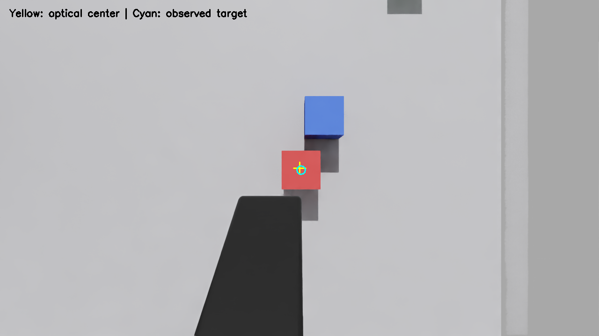

# 相机居中的二阶段观察位

后续已完成抓放提速与卡顿修复，最新重复实验见 [2026-10-28 实验报告](PERFORMANCE_20261028.md)。本文保留相机居中改版的初始实验记录。

2026-10-27。在独立机械臂实验版本中，二阶段观察默认改为 `camera_centered`，以相机光心和光轴定义观察目标。之前的固定侧移 80 mm 保留为 `legacy_offset` 对照模式。

## 目标与位姿反算

观察时，相机光心位于目标粗估位置正上方，光轴垂直向下；精定位后，机械臂才切换为夹爪对准目标的抓取位。相机与机械臂仍然刚性连接，通过机械臂运动实现。

采用列向量约定，`T_world_camera = T_world_ee @ T_ee_camera`。因此：

```text
T_world_ee_goal = T_world_camera_goal @ inverse(T_ee_camera)
```

`T_ee_camera` 读取手眼标定配置，既补偿平移，也补偿旋转。相机目标 Z 为粗估目标表面 Z 加 `camera_clearance`，当前测试使用 0.38 m。代码为 `modules/camera_viewpoint.py`；状态机调用后端反算末端观察位，不再把固定 80 mm 偏移当作默认策略。

当前安装平移约为 `[0.012674,-0.116914,-0.000172] m`。例如在近似单位安装旋转下，物体表面为 `[0.55,-0.15,0.06] m` 时，相机目标为 `[0.55,-0.15,0.44] m`，相应末端位置约 `[0.537326,-0.266914,0.439828] m`。实际程序使用完整旋转矩阵，而非这个近似平移算例。

## 观察验证：camera_center_probe_02

通过实测相机位姿和同帧 RGB-D 校验，不使用物体真值计算观察目标。

| 指标 | 单轮实测 |
|---|---:|
| 相机 XY 到粗估目标 XY 的距离 | 0.125 mm |
| 相机光轴偏离垂直向下 | 0.040° |
| 粗估目标投影到相机主点的距离 | 0.231 px |
| 二次观测目标中心到相机主点的距离 | 5.00 px |
| 二次/首次三维 XY 掩码覆盖面积比 | 0.876 |

粗估目标为 `[0.548239,-0.147456,0.060001] m`，重新估计约为 `[0.549902,-0.149811,0.060000] m`。两者不必完全相同：前者决定相机大致看向哪里，后者用于实际抓取。粗估点的投影居中，不等于未知真实物体中心必然精确居中。

黄色十字为相机主点，青色圆为重新观测的目标中心。红块完整可见，夹爪位于其下方，没有重现之前的大面积遮挡：



有效结果：`results/camera_centered/runs/camera_center_probe_02/result.json`。第一次 `camera_center_probe_01` 因仿真未就绪退出，没有执行机器人动作，不计为观察位失败；该轮启动排查后改为导出独立新文件名的场景根层副本，第二次完成了检查。

## 完整抓放回归：feedback_camera_centered_01

原始场景布局下，使用颜色分割诊断前端和新的相机居中观察位，执行了完整状态机。

| 指标 | 单轮实测 |
|---|---:|
| 目标 | red_cube |
| 尝试次数 | 1 |
| 总耗时（墙钟） | 74.19 s |
| 独立真值确认提起 | 是 |
| 最大高度增量 | 260.1 mm（含转移阶段） |
| 最终落点 XY 误差 | 11.98 mm |
| 策略 / 独立真值评价 | SUCCESS / task_success=true |

初始中心约 `[0.55,-0.15,0.035] m`，最终中心约 `[0.389961,-0.293470,0.035] m`，目标区域中心为 `[0.4,-0.3] m`。本轮满足沿用的 60 mm 区域容差。

这是一轮颜色诊断路径验证。与前次 50.3 mm 落点误差的试验相比，物体初始位置及运动路径不同，不能据此把精度变化全部归因于观察位，也没有形成稳定成功率统计。YOLO-World+SAM 的端到端表现仍需单独验证。

完整结果、状态日志、RGB-D 和真值：`results/camera_centered/runs/feedback_camera_centered_01/`。

## 实现与复现

- 默认模式：`camera_centered`；通过完整手眼变换反算观察末端位姿。
- 对照模式：`--observation-mode legacy_offset`；使用原固定侧移逻辑。
- 相机到目标表面的距离：`--camera-clearance 0.38`。
- 仍检查路径规划、目标锁定、掩码完整性和抓后/放后结果。相机居中不替代可达性、碰撞和视野检查；物体更大或相机离得更近时，仍可能被夹爪遮挡。
- 本轮新增变换方向、旋转安装、无效标定和状态机调用检查，共 23 项测试通过。

工作站启动已存在的实验容器与控制节点后执行：

```bash
docker exec arm-feedback-control-20261027 bash /experiment/src/sim_scene/run_feedback.sh \
  --output /experiment/runs/new_unique_camera_centered_run \
  --perception color --observation-mode camera_centered --camera-clearance 0.38 \
  --home 0.45 -0.12 0.5 --place-surface 0.4 -0.3 0.06 --tcp-offset 0.185
```

本地测试：

```powershell
python -m unittest discover -s D:/school/arm-feedback/tests -p test_feedback.py -v
```
