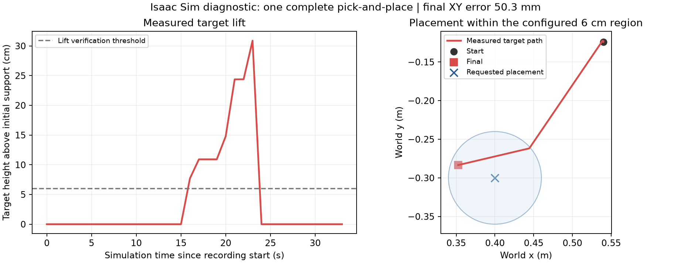

# 机械臂实验问题诊断与闭环验证

2026-10-27，工作站 ws，Isaac Sim 仿真。源码与证据保存在独立实验目录 `/home/aluupy/arm_feedback_experiments/20261027/`，本地对应 `D:/school/arm-feedback/`。

后续已按相机光心反算观察位，默认模式改为 `camera_centered`，见 [相机居中观察改版](CAMERA_CENTERED_VIEW.md)。本文旧版成功试验使用 `legacy_offset` 模式。

## 已取得的结果

`feedback_color_05` 跑通了完整的抓取、视觉验证提起、搬运、释放、视觉验证放置。策略和独立的仿真物体真值评价均判定满足当前任务条件。

| 指标 | 本轮实测 |
|---|---:|
| 抓取尝试次数 | 1 |
| 总耗时（墙钟） | 70.88 s |
| 目标物体 | red_cube |
| 目标最大离桌高度增量 | 308.9 mm（含搬运抬高阶段） |
| 最终落点 XY 误差 | 50.3 mm |
| 当前成功判据 | 目标被提起，放置在目标 XY 半径 60 mm 内并稳定 |
| 评价结果 | 策略 SUCCESS，独立真值 task_success=true |

这是颜色分割诊断路径的一次成功，不能视为已测出的稳定成功率，也不代表开放词汇路径已端到端通过。05 延续了 04 失败后物体的位置，因此 04/05 不构成严格的成对对照。初始化固定、布局固定、重复试验仍需另做。

原始结果：`results/diagnosis/runs/feedback_color_05/result.json`。逐状态记录、同步 RGB-D、标定和独立真值在同目录。图由真值轨迹生成，不包含合成运动数据：



## 诊断一：运动学模型没有明显不一致

导出实际 MoveIt 配置生成的 URDF，将 USD 保存的关节角代入正运动学，并统一到 base_link 坐标系。

- wrist_3_link 位置差约 `4.80e-7 m`，姿态差约 `4.34e-5 deg`。
- 所有七个被检查连杆的位置差都在微米量级以内。

因此没有依据把初始失败归因于 URDF 与 USD 的轴向、连杆尺寸或基座坐标不匹配。证据：`results/kinematic_comparison.json`，输入为 `results/static_scene.json` 和实际 `results/robot.urdf`。

## 诊断二：非零初始姿态配着零驱动目标

同一场景做无渲染、无 ROS、无 IK、无检测的 PhysX 对照。保留原驱动参数、场景长度单位和固定物理步长 `1/120 s`，只改变驱动初始目标。

| 条件 | 模拟 5 s 后相对保存姿态的最大关节偏差 | 随后 0.15 rad 肩部小阶跃的最终最大关节误差 |
|---|---:|---:|
| 原始零驱动目标 | 3.0500 rad | 0.000197 rad |
| 驱动目标设为保存姿态 | 0.000276 rad | 0.000276 rad |

这直接证明了原场景会在控制程序接管前先回零，而执行器本身能完成小幅关节位置控制。修复已在实验启动路径中默认启用。

证据：`results/physics_original.json`、`results/physics_preserve.json`；脚本：`tests/physics_probe.py`。没有为了得到此结果修改质量、阻尼、刚度或最大驱动力。

## 诊断三：轨迹时间、反馈时间与渲染耦合

前期代码按墙钟播放轨迹、按墙钟等待。低渲染帧率下物理时间远慢于墙钟：`home_probe_02` 的记录覆盖约 6.17 s 仿真时间，墙钟等待却已超时。原始完整轨迹未保存，约 15 s 的轨迹时长是根据当时超时公式反推的估计，不能当作原始测量值。

修复包括：

- 转换器按 `/clock` 的仿真时间插值；仿真暂停时保持当前插值点。
- 动作完成既要求仿真轨迹时段结束，也要求新关节反馈收敛；另保留有限墙钟超时。
- 每次渲染之间执行 120 个 `1/120 s` 物理小步，分离渲染频率与物理步进。没有增大物理积分步长。
- 原场景图发布的关节状态改为直接 PhysX 读取：MoveIt 只接收其模型中六个关节，完整夹爪反馈走独立话题。
- 原始场景及旧图保持只读；实验副本移除旧图后使用独立桥接，避免多个执行与发布通道混在一起。

独立 ROS_DOMAIN_ID=79 的集成测试验证了仿真时钟插值、暂停保持、单点停止取消旧轨迹，进程正常以 0 退出。证据：`results/converter_clock_test.log`。

## 诊断四：相同末端位姿被求解到遥远的 IK 分支

`feedback_color_02` 的 HOME 起点肩部角约 `3.118 rad`，同一末端目标的求解终点约 `-3.166 rad`，相差约一整圈；其他关节也切换了分支。用“末端目标不变”并不能保证重复归位几乎不动。

现在先使用实测关节角作为 IK 种子，在关节限位内选择最近的等价角，再向 MoveIt 提交明确的关节目标进行路径规划。规划失败仍停止。

| 完整执行链路验证 | 末端位置误差 | 末端姿态误差 |
|---|---:|---:|
| home_probe_04：初始化/时序修复后 | 0.842 mm | 0.443° |
| home_probe_06：再加入 IK 分支处理 | 0.223 mm | 0.027° |

两轮都独立读取仿真末端矩阵评分。它们是单轮诊断结果，不是精度分布统计。证据在 `results/diagnosis/runs/home_probe_04/` 和 `home_probe_06/`。

## 诊断五：接近后夹爪自遮挡使二次定位变坏

`feedback_color_04` 已完成下降、合爪和提升命令，但红块没有被提起；物体真值记录的最大高度增量接近零。状态机正确停止，未报成功。

近距离腕部图显示红块大半被夹爪遮住。初次估计约为 `(0.5486,-0.1473)`，二次估计约为 `(0.5696,-0.1472)`，X 偏移约 21 mm。只剩一小条目标掩码时，其质心不能再代表完整物体中心。

修复：观察位置先在 X 方向侧移 `-80 mm`，保持俯视朝向；检测完成后再把夹爪对准目标。新增掩码完整性检查：比较两次估计的三维 XY 覆盖面积，二次不足初次的 55% 时拒绝用该观测下降抓取。

修复后的 `feedback_color_05` 完成了抓放。两轮物体初始位置不同，不能把它们当成仅改变观察偏移的严格消融试验，但失败图像直接提供了自遮挡的证据。

失败图：`results/refine_wrist_04.png`；成功试验的近距离图：`results/diagnosis/runs/feedback_color_05/003_wrist.png`。

## 视觉模型的实际问题

旧图像上用五组提示词、检测阈值降到 0.001 进行离线诊断，正确重叠的候选仍很少，并出现一个框同时覆盖红、蓝两个相邻方块的情况。降低阈值不足以解决视角问题。

修正腕部相机安装并运动到有效观察位后，`sensor_fixed_mount_01` 的一个腕部帧中，三个方块的 RGB-D 诊断定位 XY 平均误差约 3.40 mm；这依然是颜色分割和理想仿真标定下的小样本结果。

在同一新图上，YOLO-World 使用 `red cube, green cube, blue cube`：

| 目标匹配框 | 置信度 |
|---|---:|
| red cube | 0.397 |
| green cube | 0.0114 |
| blue cube | 0.0080 |

红块在当前 0.02 阈值下可以检出，另外两个仍不足。不能将此解释为三个目标都已可靠识别，更不能代替 YOLO+SAM 全流程抓放试验。

旧视角数据：`results/perception_prompt_probe.json`。新视角原始检测与匹配：`results/diagnosis/diagnostics/perception_corrected_view/result.json`。

## 复现与验证

最终版本通过 20 项本地与容器单元测试，另有上述 ROS 时钟集成测试。前期两个适配器迭代运行 `feedback_color_03` / `home_probe_05` 因新代码中的 IK 返回路径错误而提前停止；该错误已修复并加入真实方法的返回顺序回归测试。`home_probe_03` 在传感器启动就绪前运行，属于启动无效试验，不是归位执行失败；主程序现有独立启动就绪等待。

在本工作站使用已存在且停止的诊断容器：

```bash
docker start arm-feedback-control-20261027 arm-feedback-sim-diag2-20261027
docker exec -d arm-feedback-control-20261027 bash /experiment/src/sim_scene/control_services.sh
docker exec arm-feedback-control-20261027 bash /experiment/src/sim_scene/run_feedback.sh \
  --output /experiment/runs/unique_new_run --perception color \
  --home 0.45 -0.12 0.5 --place-surface 0.4 -0.3 0.06 --tcp-offset 0.185 --observation-mode legacy_offset
```

主程序最多等待 180 s 启动就绪，再开始任务；每次结果必须写入一个新目录。再次运行前确认没有其他本实验的轨迹发送进程。容器启动环境保留了 `REPAIR_CAMERA_MOUNT=1` 和 `PHYSICS_STEPS_PER_RENDER=120`。

停止：`bash /home/aluupy/arm_feedback_experiments/20261027/src/sim_scene/stop_feedback.sh`。

本地复核：

```powershell
python -m unittest discover -s D:/school/arm-feedback/tests -p test_feedback.py -v
python D:/school/arm-feedback/tests/make_diagnosis_figures.py
```

## 当前剩余问题

已经有一次满足 60 mm 区域容差的完整闭环。50.3 mm 的最终位置偏差仍较大；代码目前将腕部 XY 直接送到物体目标 XY，没有根据抓取后物体在夹爪内的相对偏移补偿放置，这是一项明确的下一步检查。还需区分侧视表面估计偏差、夹持偏移、滑移和释放后的运动。

随后应固定完整环境重置、物体布局与感知配置，做重复试验，并把放置容差分档报告。当前主要验证了低速任务级闭环，尚未验证高速轨迹跟踪、完整夹爪碰撞模型、全场景障碍与附着物体规划，也尚未完成开放词汇感知的端到端成功率实验。
