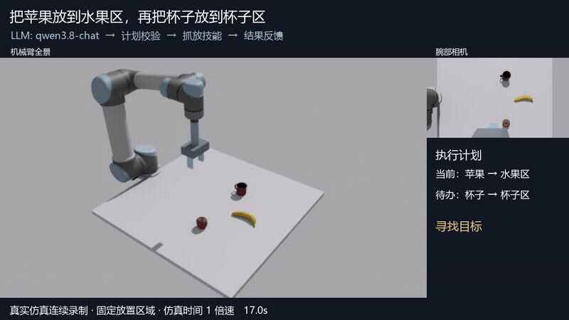
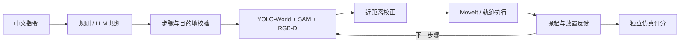
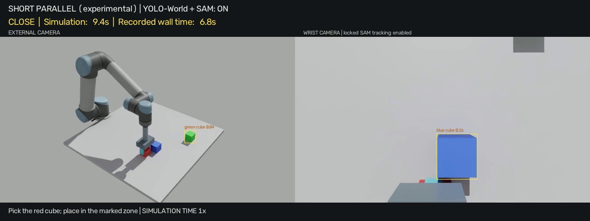
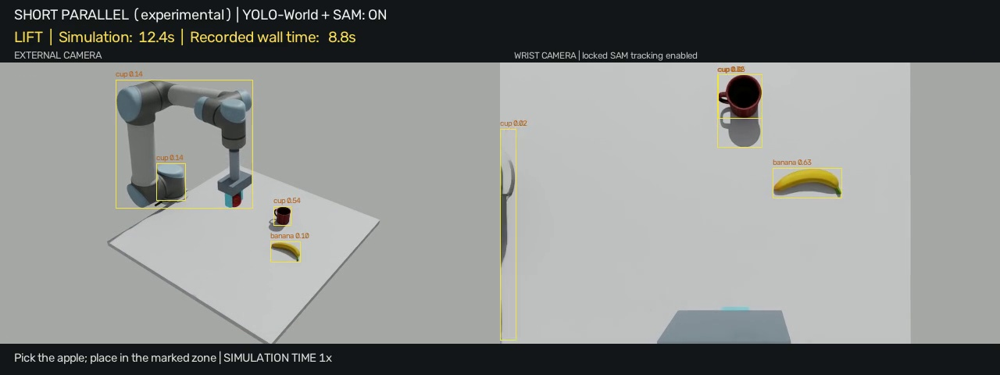
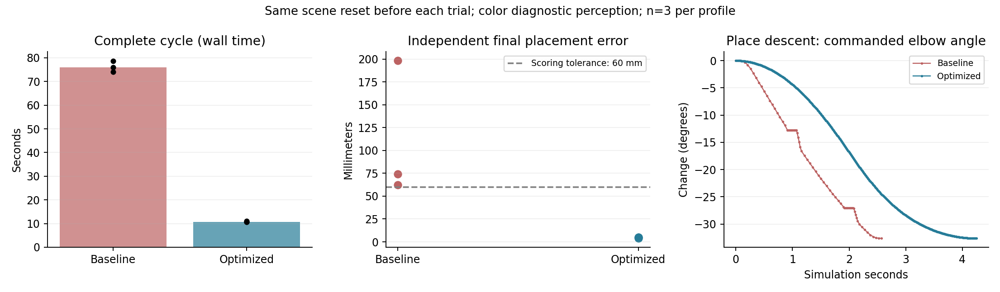

<div align="center">

# 🦾 Vision → Action

### 看见目标 · 近距离校正 · 抓取验证 · 连续执行

**UR5 桌面视觉抓放与反馈闭环实验平台**


[观看完整演示](docs/media/tabletop-agent.mp4) · [启动说明](#快速开始ws) · [场景与资产](docs/SCENES.md) · [参与开发](CONTRIBUTING.md)

</div>

[](https://github.com/allupy/isaacsim_arm_vision/blob/master/docs/media/tabletop-agent.mp4)

> **“把苹果放到水果区，再把杯子放到杯子区。”**
> 真实 Isaac Sim 渲染帧连续录制，包含全景、腕部相机、执行状态和独立评分。上方动图为原片中 17–34 秒的片段，保持原片播放速度；点击可看完整中文视频。原片按仿真时间 1 倍速播放，现实耗时与仿真时间不同。

## 从指令到闭环动作

语言规划产生受约束的抓放步骤，经校验后调用视觉抓放技能。YOLO-World 找目标，SAM 提取掩码，RGB-D 将观测转换到机械臂基座系；机械臂运动到近距离观察位再次定位，再执行抓取、提起验证和放置验证。失败时有限重试或终止，多步骤任务只在上一技能报告成功后继续。



独立评分在执行后读取仿真真值，不向规划器或抓取策略提供目标真值。当前语言接口只支持已定义的物体、目的地和抓放技能；这是有明确场景边界的仿真原型。

## Demo Gallery

| 三色方块与目标选择 | 日常物体：苹果、杯子、香蕉 |
|:---:|:---:|
| [](docs/media/multicolor-cubes.mp4) | [](docs/media/everyday-objects.mp4) |
| [▶ 多色方块实录](docs/media/multicolor-cubes.mp4) | [▶ 日常物体实录](docs/media/everyday-objects.mp4) |

**连续两步抓放**：主视频运行 `agent_llm_video_20261028` 使用 LLM 生成计划，YOLO+SAM 执行苹果和杯子抓放；该次独立评分通过，落点 XY 误差分别为 **5.1 mm / 6.7 mm**。[计划](docs/evidence/agent_runs/agent_llm_video_20261028/plan.json) · [评分](docs/evidence/agent_runs/agent_llm_video_20261028/audit.json)

**实体目的地原型**：[苹果放盘子、杯子放杯架的视频](docs/media/physical-destinations-prototype.mp4)。承托物由 RGB ArUco 标记与深度定位；该次苹果通过，杯子偏差 **27.4 mm**，超过 **21 mm** 的内部放置容差，整项任务独立评分未通过。[评分记录](docs/evidence/agent_runs/agent_destinations_20261028/audit.json)

## 当前能力与实验结果

**入口说明**：近期闭环 Demo 使用 `feedback_runner.py`，通过 `scripts/arm.sh` 启动。`main.py` 仍是旧的交互式两阶段抓取流程；同仓同步不等于两条入口的控制逻辑相同。其检测配置已修正，并增加只观察模式，详见 [main.py 检查与修正](docs/MAIN_ENTRY_REVIEW.md)。

| 模块 | 当前实现 |
|---|---|
| 视觉 | YOLO-World 开放词汇检测、SAM 分割、深度定位、视觉目标锁定 |
| 二次观察 | 基于相机光心/光轴的近距离观察位，随后切换到夹爪抓取位 |
| 反馈策略 | 状态机、提起/放置验证、有限恢复、异常终止 |
| 执行 | MoveIt/IK、整段轨迹、仿真物理步插值执行 |
| 场景 | 工作台三色方块、短平行夹爪、YCB 日常物体、带标记盘子/杯架 |
| 任务编排 | 受约束中文指令、可选 LLM、顺序技能、计划/事件/结果记录 |

在固定红块场景、**颜色诊断感知**、各 3 次的历史对照中，优化前后现实耗时中位数为 **75.99 → 10.72 秒**，仿真时间中位数为 **32.76 → 23.83 秒**。这组结果反映了仿真执行与调度优化，不能外推为真机性能或 YOLO+SAM 的稳定成功率。[实验说明](PERFORMANCE_20261028.md) · [原始汇总](docs/evidence/runs/performance_summary.json)



## 快速开始（ws）

现有 ws 环境使用 Docker；需要 NVIDIA GPU、`isaac-sim-omnilrs-0513:latest`、`moveit_aluupy:latest` 镜像，以及已编译的 ROS 2 / MoveIt 工作空间。模型权重由工作站提供，未放入 Git。新机器的依赖和限制见 [环境说明](docs/SETUP.md)。

```bash
git clone git@github.com:allupy/isaacsim_arm_vision.git
cd isaacsim_arm_vision

# 每人独立输出目录、容器名和 ROS Domain；先与其他使用者协调 GPU。
source .env.example  # 示例配置为 drs；其他同学应修改身份与 Domain
python3 scripts/check_assets.py
bash scripts/arm.sh check
bash scripts/arm.sh init

# 默认：短平行夹爪 + 苹果/香蕉/杯子场景
bash scripts/arm.sh up
bash scripts/arm.sh status
```

先在宿主机查看 `.runtime/<user>/sim/sim.log`，等待场景和相机就绪，再执行：

```bash
# 先检查计划，不驱动仿真
bash scripts/arm.sh agent --dry-run

# 新运行必须使用全新的 run-id，避免覆盖历史结果
bash scripts/arm.sh agent --run-id my_first_sort --reset-scene --record
bash scripts/arm.sh audit --run-id my_first_sort

# 停止当前用户配置的两只容器
bash scripts/arm.sh stop
```

LLM 模式可用 `agent --planner llm --api-base <HTTPS接口> --model <模型名>`；运行时通过 `ROBOT_LLM_API_KEY` 或 `--api-key-stdin` 提供凭据。默认规则规划无需 API。API 可用性取决于所选服务。

切换场景前先停止当前容器，再将 `sim_scene/runtime_optimized.json`、`runtime_short_parallel.json` 或 `runtime_destinations.json` 复制到 `$ARM_RUN_ROOT/sim/runtime_config.json`（默认 `.runtime/<user>/sim/`），然后启动。方块场景使用 `feedback` 单技能入口；`agent` 当前要求 everyday + short_parallel。

## 仓库结构

```text
main.py                  原交互式视觉抓放入口
feedback_runner.py       反馈抓放入口
modules/                 视觉、几何、策略、运动与场景适配
agent_workflow/          指令规划、校验、顺序执行、独立审计
sim_scene/              仿真桥接、运行配置与历史诊断脚本
scripts/arm.sh           当前统一宿主机启动入口
scenes/workbench/        已收录的初始 USD 场景
assets/ycb/              日常物体网格和纹理
ros2/ur5_moveit_config/  ws 的 MoveIt 配置源码快照
tests/                  单元检查、仿真实验和评估工具
docs/                   环境、演示、评分证据与迁移记录
.runtime/               每用户运行结果与缓存（不提交）
```

原项目提交历史完整保留；最近实验源码已并入本仓库。历史实验目录继续归档，后续开发以此仓库为准。历史诊断脚本保留了机器路径，统一入口使用 `scripts/arm.sh`。[迁移记录](docs/MIGRATION.md)

## 验证与参与

若需要排查 YOLO 漏检，在已加载 ROS 环境的控制容器内先运行下面的只观察命令（从仓库目录执行）：

```bash
# 三色方块场景：只检测、保存图像和置信度，不初始化机械臂控制器
python3 main.py --once --observe-only --classes "red cube" "green cube" "blue cube"

# 日常物体场景：类别必须与图像中的目标对应
python3 main.py --once --observe-only --classes apple banana cup
```

启动日志打印最终权重路径、类别、阈值、SAM 型号和相机话题。YOLO 检测框、SAM 掩码和位姿估计失败分别诊断；阈值降低会增加误识别，不能代替场景验证。

```bash
python -m unittest discover -s tests -p test_feedback.py
python -m unittest discover -s tests -p test_performance.py
python -m unittest discover -s tests -p test_main_entry.py
python agent_workflow/test_workflow.py
python scripts/check_assets.py
```

检查范围和已知限制见 [验证记录](docs/VALIDATION.md)。每位同学独立克隆、按任务开分支，通过合并请求集成；分工与验收建议见 [CONTRIBUTING.md](CONTRIBUTING.md)。
