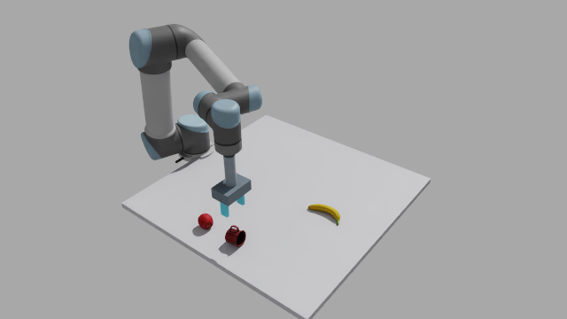

# main.py 实机环境中的仿真验证

2026-10-30，Asia/Shanghai。测试源码提交：`5c2e5b14d17903a5d4116ba34343dce24bfa09d5`。本页及配套录像为本次新产生的证据；测试对象是 ws 上的 Isaac Sim 仿真，不是真实机械臂。

**结论：交互入口、实时观察和完整闭环搬运已经跑通；杯子直立放置未通过。** 本轮没有修改抓取算法、阈值、模型、场景或运行配置。通过 `main.py` 菜单输入命令，实际创建 `feedback_runner.py` 子进程，使用 YOLO-World + SAM、MoveIt 和仿真物理轨迹执行。

## 实测结果

| 项目 | 结果 | 证据 |
|---|---|---|
| `status → o → last → q` | 正常返回；全景识别到 cup、banana、apple，并给出三维位置；当前初始姿态的腕部视角没有候选 | [观察结果](evidence/main_live_20261030/interactive_20261030_105144_559d7252/result.json) |
| `t apple → p fruit_zone → plan → d → last → status → q` | 闭环与独立搬运评分均通过；抬升 263.5 mm，落点 XY 误差 12.4 mm | [苹果结果](evidence/main_live_20261030/interactive_20261030_105648_46376335/result.json) · [录像](media/main_apple_20261030.mp4) |
| `t cup → p cup_zone → plan → d → last → status → q` | 完成搬运，抬升 261.1 mm，落点 XY 误差 1.5 mm；**杯子释放后侧倒，不能算直立放置成功** | [杯子结果](evidence/main_live_20261030/interactive_20261030_105740_69d6aa87/result.json) · [录像](media/main_cup_20261030.mp4) |

两次抓放子进程退出码均为 0，交互台恢复菜单，`last` 可读结果，`status` 显示 `blocked=false`。每个目标仅完成一次正常抓放，不能据此估计成功率。苹果观察置信度约 0.095，初始腕部漏检仍存在，不能宣称 YOLO 识别稳定性已经解决。

### 为什么杯子侧倒，结果仍是 success=true？

当前 `EvaluationRecorder.summary()` 检查选中目标、抬升至少 60 mm、固定区域 XY 误差小于 60 mm、放置高度误差小于 35 mm，**没有检查姿态或直立程度**。本次杯子高度误差 7.4 mm，满足这些条件，但录像和最终截图明确显示它侧倒。因此，JSON 的 `task_success=true` 只代表现有搬运指标通过；“杯子直立放置”需求未通过。后续需同时改进释放策略和姿态验收，不能仅降低阈值或依赖成功标志。

## 启动与就绪验证

独立容器 `arm-main-validation-20261030-sim` / `arm-main-validation-20261030-control`，ROS Domain 200，仿真 GPU 2、控制 GPU 3。使用默认 `runtime_everyday_demo.json` 和现有工作站缓存；没有停止其他人的容器。

1. 先执行 `bash scripts/arm.sh sim`，等待日志出现 `=== PLAYING ===` 和持续增长的 `SENSOR frame=...`，确认 `sim/latest.json` 是本次启动的新数据。`run_feedback_sim.py` 自动执行 Play，无需手动点击。
2. 再执行 `bash scripts/arm.sh control`，启动 MoveIt2 和 robot_state_publisher。
3. 在控制容器内订阅并检查两路 RGB、深度、标定和关节状态，同时检查 `/compute_cartesian_path` 服务。实测两路图像 640×360、消息年龄约 14–20 ms、关节状态约 1.4 ms；深度包含有限正值，服务就绪。[检查结果](evidence/main_live_20261030/readiness.json) · [本次检查脚本](evidence/main_live_20261030/readiness_probe.py)
4. 最后执行 `main.py`。本次通过 `docker exec -i ... bash /experiment/src/sim_scene/run_python.sh main.py` 从标准输入发送上述菜单命令，以便保存完整交互日志；没有使用 `--dry-run`、假控制器或替换检测结果。

当前 `arm.sh up` 先启动控制容器再启动仿真，并不等待就绪。**容器 running 或应用 app ready 不代表已经 Play、相机出图或 MoveIt 可用。** 场景/物理/渲染初始化本次耗时数分钟，必须等真实就绪后再开始任务。各终端须使用相同的项目配置、输出目录和 ROS Domain。

## 保留的失败与恢复

观察成功后的第一次抓放尝试，在真正运动前中断。验证时直接通过 SCP 写入 `video_request.json`，仿真读到了半写入的空 JSON，在 `ExperimentVideoCapture.requests()` 抛出 `JSONDecodeError`，随后 Isaac 清理时发生段错误；这不是 YOLO 或 main.py 的抓取失败。[崩溃日志](evidence/main_live_20261030/sim_crash_first.log)

向正在等待传感器的 runner 发送 SIGINT 后，子进程返回 130、记录 `interrupted`，交互菜单继续工作。该次未创建运动控制器，`state_known=true` **不能作为运动中成功保持或急停的证据**。[中断结果](evidence/main_live_20261030/interactive_20261030_105223_75d8fe9a/result.json)

重启本次测试仿真，重新检查传感器/MoveIt；录像请求改为先上传 `.pending` 文件，再在同目录 `mv` 原子替换为 `video_request.json`。随后苹果、杯子测试正常完成。原录像请求读取函数未在本轮修改，其对不完整输入的容错仍是已知限制。

## 日志和录像

- [机器可读汇总](evidence/main_live_20261030/summary.json)、[观察交互日志](evidence/main_live_20261030/interactive_observe.log)、[苹果交互日志](evidence/main_live_20261030/interactive_apple_retry.log)、[杯子交互日志](evidence/main_live_20261030/interactive_cup.log)。各运行目录还保存调用参数、观测事件和轨迹事件。
- 仓库文本日志清理了行尾空白；崩溃日志移除了包含镜像构建凭据信息的环境元数据段，保留异常和错误栈。ws 保留未经处理的原始日志。
- 两段录像分别采集 1168 / 1181 组实时渲染帧，采集器记录丢帧均为 0；按记录的墙钟时间采样为 25 fps，左侧全景、右侧腕部，包含模型初始化等待。输出时长 25.80 / 26.12 秒。H.264 输出逐帧解码校验通过，共 1298 帧。
- ws 完整原始材料：`/home/aluupy/project_sync_backups/20261030/main_validation/`，包括 RGB-D、真值记录、逐帧 JPEG、仿真日志和失败记录。run ID 使用容器 UTC 时间，报告日期使用 Asia/Shanghai。
- 验证结束后停止本次两只测试容器，保留原始材料和已停止的容器供复查。
- 未验证真机、GUI 窗口 `v`、随机场景稳定成功率、杯子直立放置，以及运动过程中的 Ctrl+C 保持效果。
